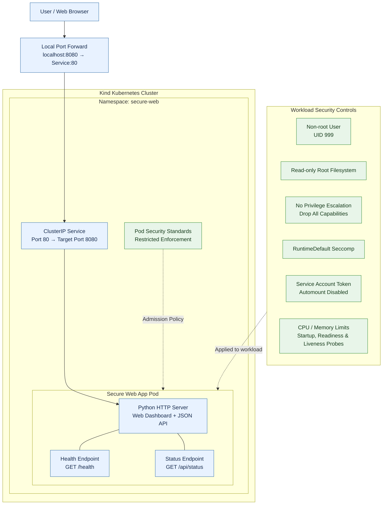

# Kubernetes Secure Web App

A security-focused web application deployed to a local Kubernetes cluster using Docker and Kind. This project demonstrates container hardening, Kubernetes workload security, health monitoring, and Pod Security Standards enforcement.

## Architecture

Browser → Kubernetes Service → Application Pod → Python HTTP Server

- **Application:** Python HTTP server with a web dashboard and JSON endpoints.
- **Containerization:** Docker image configured to run as a non-root user.
- **Orchestration:** Kubernetes Deployment and ClusterIP Service on a local Kind cluster.
- **Preventive controls:** Restricted Pod Security enforcement and hardened container settings.

## Security Controls

- Non-root execution (`UID 999`)
- Read-only root filesystem
- Privilege escalation disabled
- All Linux capabilities dropped
- `RuntimeDefault` seccomp profile
- Automatic service-account token mounting disabled
- CPU and memory requests and limits
- Startup, readiness, and liveness probes
- Kubernetes Restricted Pod Security Standard enforcement

## Validation Results

| Test | Observed result |
|---|---|
| `GET /health` | Returned `healthy` |
| `GET /api/status` | Returned `running` |
| Runtime identity | Ran as `appuser`, UID 999 |
| Root filesystem write test | Blocked |
| Insecure Pod admission test | Rejected by Kubernetes |
| Rejected pod lookup | Returned `NotFound` |

## Run Locally in Kubernetes

Start port forwarding:

```powershell
kubectl port-forward -n secure-web service/secure-webapp-service 8080:80
```

Then test the endpoints in another PowerShell terminal:

```powershell
Invoke-RestMethod http://localhost:8080/health
Invoke-RestMethod http://localhost:8080/api/status
```

Keep the port-forward terminal running during testing.

## Project Scope

This is a local security engineering lab demonstrating container and Kubernetes hardening. The documented results apply to the tests performed; they do not establish that the application is free of vulnerabilities or replace a comprehensive security assessment.

## Architecture

The application runs in a local Kubernetes cluster provisioned with Kind. Requests reach the Python web application through a Kubernetes Service, while workload-level security controls reduce container privileges and restrict insecure pod configurations.



### Request flow

1. The user accesses the application through a local port-forward.
2. The Kubernetes ClusterIP Service forwards traffic to the application pod.
3. The Python server serves the dashboard and API endpoints.
4. Kubernetes health probes monitor application availability.
5. Container hardening and Restricted Pod Security enforcement help prevent insecure workloads.